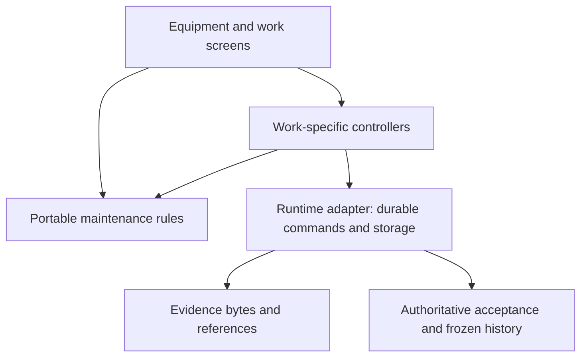

# Architecture: maintenance first

Current cleanup: [ARCH-001](specs/ARCH-001-architecture-cleanup.md).
Boundary decision: [0020](decisions/0020-maintenance-domain-and-runtime-boundaries.md).
This map distinguishes working code from the local-first target. It does not
claim the existing application has already migrated.

## Shape of the application

Keep one Flutter application organised around equipment and work. Give a
maintainer one place to change a rule, a clear command to perform an action,
and a small storage/transport boundary. Keep ordinary screens unaware of
Automerge, TLS, Supabase error codes and database migrations where practical.
Do not introduce a plugin framework, microservices, a universal repository,
or a second configurable workflow engine to achieve that separation.

There is one active authority for each workflow. A successful transfer is not
an approval. An editable document is not an approved report. A retry is the
same command, not a new instruction with a new identity.

## Where to change something now

| Concern | Current entry point | Boundary |
| --- | --- | --- |
| Checklist value and range rules | [`lib/domain/checklist.dart`](../lib/domain/checklist.dart) | Pure Dart; used by builder, execution, history and submission. |
| Report completeness, starting meter and linked evidence | [`lib/domain/work_report.dart`](../lib/domain/work_report.dart) | Pure Dart; internal and provider work use the same rules. Completion does not automatically verify a fault or grant approval. |
| Frozen report retry identity and input | [`lib/domain/report_command.dart`](../lib/domain/report_command.dart) | Pure Dart; keeps operation ID, original revision, action and a copied payload. |
| Company working-role capabilities | [`lib/domain/membership_access.dart`](../lib/domain/membership_access.dart) | Pure Dart policy; server authorization still enforces the retained application's access. |
| Provider draft persistence and submission | [`provider_report_draft.dart`](../lib/features/membership/provider_report_draft.dart) | Hosted adapter; widgets supply fields and navigate after acknowledgement. |
| Hosted identity mapped into old routes | [`hosted_profile_adapter.dart`](../lib/features/auth/hosted_profile_adapter.dart) | Explicit compatibility adapter. Never treat a route name as a new capability grant. |
| Confirmed write rejection versus uncertain outcome | [`rpc_failure.dart`](../lib/core/rpc_failure.dart) | Hosted error policy; preserve exact retries after unknown completion. |
| Ink capture | [`signature_pad_widget.dart`](../lib/features/service_reports/signature_pad_widget.dart) | Flutter drawing and PNG export; no commercial signature SDK. |

`dart run tool/verify_domain.dart` compiles and exercises the domain rules
without a Flutter engine or service credentials. It also rejects imports from
UI, plugins and runtime adapters into `lib/domain/`. The guarded project
verification runs it alongside analysis and the Flutter suite.

## Local-first target and what survives

The separate Sync Lab owns the feasibility experiment: local SQLite
transactions, editable Automerge documents through Rust, separately hashed
photos, confirmed device enrollment, pinned TLS, immutable approval receipts,
and replacement-phone recovery. These mechanisms must remain behind the work
boundary. Flutter/Field Notes, maintenance vocabulary, procedure snapshots,
nullable meter readings with units, exact retries and frozen history survive.

The lab's desktop OS account is its owner boundary. Device credentials are
not a second person-role system. Multi-worker capabilities need a separate
complete scope; do not infer company ownership from possession of a phone.

The lab proves one synthetic inspection on Android and Linux. It does not
implement the retained application's recurring work, inventory, billing,
customer/provider sharing, multiple workers or company-computer recovery.
Keep those existing implementations until their replacement is scoped and
verified. Do not port all those screens into the experiment to make it look
like the finished product.

## Work deliberately avoided

Do not consolidate the hosted SQL wrapper chain, redesign Supabase Auth/RLS,
or rebuild cloud delivery just to discard it in the local-first target.
Preserve deployed migration history and fix concrete defects while the old
runtime remains available. Shared rules are the migration asset; SQL contracts
are behavioral references, not a new engine to copy literally into Dart.

Likewise, do not unify every internal/provider screen prematurely. Common
execution concepts belong together; customer publication, financial snapshots,
inspection certificates and review authority remain explicit policies.

## The next integration must be a complete workflow

After the lab's evidence is reviewed, the next implementation scope should
migrate equipment -> one inspection/work order -> offline evidence -> exact
submission -> office review -> history -> replacement-device recovery.

It must select a destination base that preserves Build 45's delivered work,
resolve the two meanings of NEXT-011, and name exactly one write authority.
For each record it must preserve IDs, original units, procedure versions,
attachments and historical approvals. Import and rollback must be rehearsed
before real records are switched. Do not dual-write to SQL and a local authority
as an undocumented shortcut. No merge or production cutover is selected here.

The test for simplicity is practical: a contributor can find the rule, change
it once, and demonstrate the ordinary workflow. The project still has large
legacy screens and hosted coupling; this cleanup contains useful boundaries
without pretending those remaining systems have disappeared.
