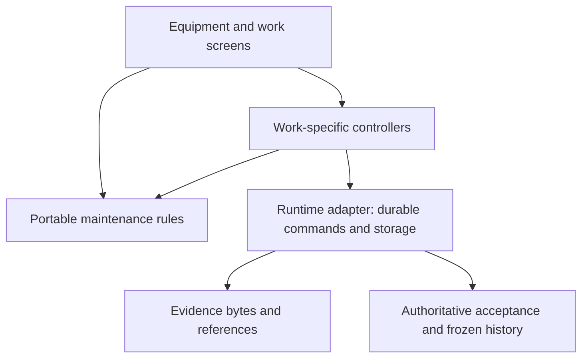

# Architecture: maintenance first

Current cleanup: [ARCH-001](specs/ARCH-001-architecture-cleanup.md).
Selected experimental local workflow: [LF-001](specs/LF-001-local-maintenance-slice.md),
with [LF-002](specs/LF-002-work-progress-and-review.md) continuing current-work
clarity on a separate descendant of LF-001's independently reviewed source.
Boundary decision: [0020](decisions/0020-maintenance-domain-and-runtime-boundaries.md).
The hosted application remains the rollback path. The experimental local app has
its own identity, storage and launch/build helper; no production migration,
installation or cutover has occurred.

## Shape of the application

Keep one Flutter application organised around equipment and work. Give a
maintainer one place to change a rule, a clear command to perform an action,
and a small storage/transport boundary. Keep ordinary screens unaware of
Automerge, TLS, Supabase error codes and database migrations where practical.
Do not introduce a plugin framework, microservices, a universal repository,
or a second configurable workflow engine to achieve that separation.

There is one active authority for each workflow. A successful transfer is not
an approval. An editable document is not an approved report. A retry is the
same command, not a new instruction with a new identity.

## Where to change something now

| Concern | Current entry point | Boundary |
| --- | --- | --- |
| Checklist value and range rules | [`lib/domain/checklist.dart`](../lib/domain/checklist.dart) | Pure Dart; used by builder, execution, history and submission. |
| Report completeness, starting meter and linked evidence | [`lib/domain/work_report.dart`](../lib/domain/work_report.dart) | Pure Dart; internal and provider work use the same rules. Completion does not automatically verify a fault or grant approval. |
| Frozen report retry identity and input | [`lib/domain/report_command.dart`](../lib/domain/report_command.dart) | Pure Dart; keeps operation ID, original revision, action and a copied payload. |
| Company working-role capabilities | [`lib/domain/membership_access.dart`](../lib/domain/membership_access.dart) | Pure Dart policy; server authorization still enforces the retained application's access. |
| Provider draft persistence and submission | [`provider_report_draft.dart`](../lib/features/membership/provider_report_draft.dart) | Hosted adapter; widgets supply fields and navigate after acknowledgement. |
| Hosted identity mapped into old routes | [`hosted_profile_adapter.dart`](../lib/features/auth/hosted_profile_adapter.dart) | Explicit compatibility adapter. Never treat a route name as a new capability grant. |
| Confirmed write rejection versus uncertain outcome | [`rpc_failure.dart`](../lib/core/rpc_failure.dart) | Hosted error policy; preserve exact retries after unknown completion. |
| Ink capture | [`signature_pad_widget.dart`](../lib/features/service_reports/signature_pad_widget.dart) | Flutter drawing and PNG export; no commercial signature SDK. |

`dart run tool/verify_domain.dart` compiles and exercises the domain rules
without a Flutter engine or service credentials. It also rejects imports from
UI, plugins and runtime adapters into `lib/domain/`. The guarded project
verification runs it alongside analysis and the Flutter suite.

## Local-first target and what survives

The selected real slice is now `experiments/maintenance_local/`, based on the
reviewed retained app rather than a wholesale lab merge. Normal office setup
creates actual equipment, authored published checklists and prepared inspection
snapshots. It supports job-scoped offline work/evidence, frozen submissions,
exact office decisions, immutable history and strict private same-identity
recovery. Reviewed native lab mechanisms were ported selectively. See the
[runtime boundary summary](specs/LF-001-API-BOUNDARIES.md) for wire, startup,
history and recovery differences. Automated evidence does not replace physical
acceptance or a person/account identity design.

| Experimental concern | Entry point | Boundary |
| --- | --- | --- |
| Real equipment, procedure snapshots and draft completeness | `maintenance_local/lib/maintenance_domain.dart` | Pure Dart, reusing the portable checklist rules; no storage or authority. |
| Current draft and immutable-version progress | `maintenance_local/lib/job_progress.dart` (LF-002) | Typed pure projection; exact document identity, no inferred approval or persisted workflow state. |
| Coherent progress reads | `maintenance_local/lib/work_progress_reader.dart` (LF-002) | Small read-only adapter captures bytes/context/history and checks evidence; late snapshots are fenced. |
| Catalog/documents and frozen commands | `maintenance_local/lib/lab_store.dart` | Existing serial SQLite/native boundary; job IDs and frozen context remain explicit. |
| Office decisions and command/history validation | `maintenance_local/lib/approval_rules.dart` | Exact-version checks and immutable receipts; enrollment and office role remain runtime authority. |
| Evidence integrity | `maintenance_local/lib/evidence_store.dart` | Hashed bytes outside editable documents; complete bytes required, partials never inferred complete. |
| Local transfer and enrollment | `maintenance_local/lib/local_sync.dart` | Pinned TLS, office confirmation/revocation and all-job verified-send status. |
| Private office recovery | `maintenance_local/lib/office_backup.dart` | Coherent maintenance-v2 snapshot, strict ownership/schema/history, identity verification and phone reconfirmation. |
| Work screens | `maintenance_local/lib/ui/` | Input/navigation and composed projections; no new schema, wire or authority policy in LF-002 widgets. |

LF-002's projection replaces widget-derived status that could call an edited
draft approved merely because an older submission has a receipt. The existing
decision guard still owns approval. Pending review and immutable decided history
remain separate facts; selecting a job cannot change another job's projection.

The separate Sync Lab owns the feasibility experiment: local SQLite
transactions, editable Automerge documents through Rust, separately hashed
photos, confirmed device enrollment, pinned TLS, immutable approval receipts,
and replacement-phone recovery. These mechanisms must remain behind the work
boundary. Flutter/Field Notes, maintenance vocabulary, procedure snapshots,
nullable meter readings with units, exact retries and frozen history survive.

The lab's desktop OS account is its owner boundary. Device credentials are
not a second person-role system. Multi-worker capabilities need a separate
complete scope; do not infer company ownership from possession of a phone.

The earlier lab proved one synthetic inspection on Android and Linux. The real
slice adds local catalog/work creation and company-computer recovery with tested
limits, but it does not implement the retained application's recurring work,
inventory, billing, customer/provider sharing or multiple-person authorization.
Keep those existing implementations until their replacement is scoped and
verified. Do not port all those screens into the experiment to make it look
like the finished product.

## Work deliberately avoided

Do not consolidate the hosted SQL wrapper chain, redesign Supabase Auth/RLS,
or rebuild cloud delivery just to discard it in the local-first target.
Preserve deployed migration history and fix concrete defects while the old
runtime remains available. Shared rules are the migration asset; SQL contracts
are behavioral references, not a new engine to copy literally into Dart.

Likewise, do not unify every internal/provider screen prematurely. Common
execution concepts belong together; customer publication, financial snapshots,
inspection certificates and review authority remain explicit policies.

## The next integration must be a complete workflow

LF-010 extends the office side with explicitly typed corrective planning.
Its pure model derives revisioned drafts and one-per-fault associations from
immutable command receipts; the adapter composes the existing serial queue
and SQLite transaction. Corrective drafts live in an office-private ledger,
outside inspection catalog jobs and native checklist documents. This keeps
inspection submissions/approvals and existing phone/agent readers truthful.
The first durable planning intent atomically selects workspace format 3;
early reader guards and matching backup format prevent unsupported older
readers from treating repair drafts as inspections. The compatibility proof
was executed against unchanged prior source before implementation. Creation,
association, planning edits and recovery are covered together; execution and
fault verification remain explicit future work. See
[LF-010](specs/LF-010-corrective-planning.md).

The implemented LF-001 experimental workflow follows equipment -> one inspection/
work order -> offline evidence -> exact submission -> office review -> history ->
replacement-device recovery. LF-002 improves its ordinary work visibility using
read-only projections. Any later production integration must retain this complete
workflow and rehearse migration and rollback with deliberately authorized data.

The selected experimental destination preserves reviewed Build 45 work, uses
branch-qualified backlog IDs and names the office as its one write authority.
A production integration must still reconcile the two meanings of NEXT-011.
For each record it must preserve IDs, original units, procedure versions,
attachments and historical approvals. Import and rollback must be rehearsed
before real records are switched. Do not dual-write to SQL and a local authority
as an undocumented shortcut. No merge or production cutover is selected here.

The test for simplicity is practical: a contributor can find the rule, change
it once, and demonstrate the ordinary workflow. The project still has large
legacy screens and hosted coupling; this cleanup contains useful boundaries
without pretending those remaining systems have disappeared.
